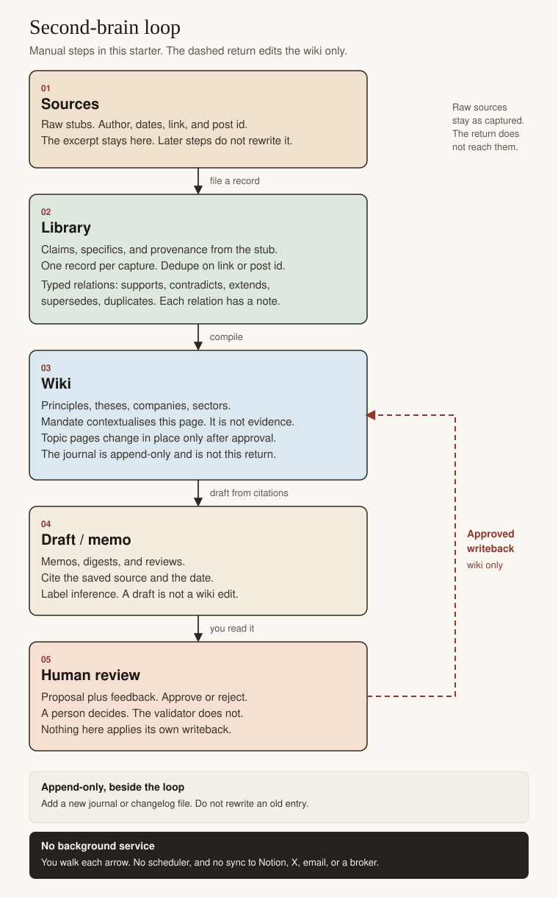
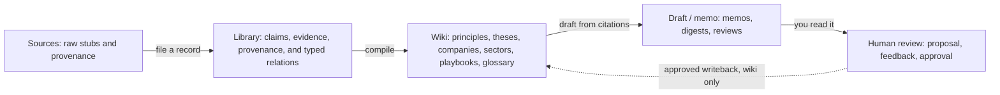

# Second brain starter

Repository: [sethchongss/investmentOS-secondbrain](https://github.com/sethchongss/investmentOS-secondbrain).

A portable markdown vault for investment research. You capture a source, file the claim in your own words, link agreements and contradictions, and compile wiki pages only after a person approves the edit.

It is folders, templates, prompts, one fictional example, and a small validator. It is not a broker, not a data feed, and not a service that runs while you are away. An agent can draft text if you paste a prompt into one you already use. The agent does not approve its own writeback.

This is not investment advice. Nothing here recommends a security or promises a return. The worked example is fictional.

Human review and the before/after changelog are the writeback workflow **in this starter**. They are files you edit. They are not a description of a live system.

## The loop



The drawing is the reusable picture: [docs/diagrams/second-brain-loop.svg](docs/diagrams/second-brain-loop.svg). The same loop in Mermaid, which GitHub renders:



Plain-text fallback, if the picture and the Mermaid block do not render:

```text
MANUAL RESEARCH LOOP
This starter has no background service and no autonomous writeback.

Sources
  raw stubs, with author, dates, link, and post id
  the excerpt stays here and is not rewritten
        |
        | you file one library record for the capture
        v
Library
  claim, specifics, and the other evidence fields
  provenance copied from the source stub
  typed relations between records:
    supports, contradicts, extends, supersedes, duplicates
        |
        | you compile
        v
Wiki
  principles, theses, companies, sectors
  also playbooks and glossary
  topic pages change in place only after approval
  the journal is not on this return path; it is append-only
        |
        | you draft from citations
        v
Draft / memo
  memos, digests, and reviews
  each sourced sentence names a saved record and a date
  inference is labeled as inference
        |
        | you read it and leave feedback
        v
Human review
  a proposal you can edit, approve, or reject
  a person decides; the validator does not
        |
        | dashed line: approved writeback
        v
Wiki only
  the approved text replaces the topic page in place
  raw sources are not rewritten
  library claim sentences are not rewritten to match the new belief
  a new changelog file records the before and after
  a new journal file may record what you decided; the old entry stays

Solid steps are things you do in an editor, or by pasting a prompt
into an agent you already use. Nothing here runs on a schedule.
Nothing here syncs Notion, X, email, or a broker.
```

[docs/diagrams/second-brain-loop.txt](docs/diagrams/second-brain-loop.txt) is that same text. Journal entries and changelog entries sit beside the loop. They are append-only. The dashed arrow does not point at them, and it does not point at raw sources.

You walk each solid arrow in an editor. Longer notes on the same map are in [docs/architecture.md](docs/architecture.md).

## Quickstart

About fifteen minutes, with Python 3.10 or newer and any text editor. There is nothing to install. From the repository root:

```bash
python3 tools/validate_vault.py examples/low-oriole-metering --example
python3 -m unittest discover -s tests -v
python3 tools/quickstart_drill.py
```

You should see the example pass, the unit tests pass, and the drill pass. The drill copies the example to a temp folder, drops an unfinished library template onto the copy, checks that the validator names `REPLACE_ME`, removes that file, adds one synthetic journal entry, and checks that the copy passes again. It does not modify the example in the repo.

Then read three files:

1. [Company page, after the approved edit](examples/low-oriole-metering/wiki/companies/low-oriole-metering.md)
2. [Changelog, before and after](examples/low-oriole-metering/changelog/2026-03-21-backlog-correction.md)
3. [Memo, sources separate from inference](examples/low-oriole-metering/output/memos/2026-03-21-low-oriole-backlog.md)

If you want a model to draft a capture, paste [prompts/capture.md](prompts/capture.md) into an agent you already use, with the templates it names. Save the result yourself and run the validator. The prompt does not run on its own.

## Walkthrough

Low Oriole Metering is a fictional private meter company. Brack Flags is a fictional add-on. The towns, the ledger, the desk, and the people are made up. Links look like `synthetic://` and are not web addresses. The full reading order is in the [example readme](examples/low-oriole-metering/README.md).

On 14 Jan 2026 a fictional note reports $180 million of contracted backlog, up 22%, including unexercised options, and says Brack Flags rode on about 40% of shipments. That capture stays worded that way in [the January stub](examples/low-oriole-metering/raw/src-lom-20260114.md) and in [lib-lom-001](examples/low-oriole-metering/library/lib-lom-001.md).

On 3 Feb a fictional award list shows one of three contracts with Brack Flags. That **contradicts** the 40% sentence. It is not a new rate. The company page is left alone. The [4 Feb journal](examples/low-oriole-metering/wiki/journal/2026-02-04-awards.md) says why.

On 11 Mar a fictional ledger states core backlog of $112 million and an options bucket of $68 million, and says firm orders convert in about 14 months rather than within two quarters. That record **supersedes** the January total and the 22% rate tied to it, and **extends** a short primer on comparable backlog figures. A 12 Mar clip repeats the ledger under a new link. That is a **duplicate**, not a second confirmation. An 18 Mar Q&A, written for the example, **supports** the ledger. Support and duplicate are different: one is a new source, the other is the same item again.

A proposal drafted "backlog is unreliable" and conviction 1. A person approved a narrower edit on 21 Mar: replace the figure, cite the March sources, set conviction on the growth rate to 2, leave the attach claim contested, leave the raw stub and the January journal untouched. The company page is the after. The changelog is the before and after. The [21 Mar journal](examples/low-oriole-metering/wiki/journal/2026-03-21-after-approval.md) is a new file.

A recurring principle, "a backlog rate needs a definition," cites three library records. The attach-rate page is marked developing because it has one supporting record. Ordinary facts do not use the three-record bar. A 2 Apr recall logs a missed answer and does **not** edit the principle.

## Folder map

```text
schema/            field list and relation rules (vault.schema.json)
templates/         blank records, copied into a vault
prompts/           paste text for an agent you already use
docs/              architecture, privacy, publication, integrations
docs/diagrams/     SVG and plain-text loop, safe to reuse
examples/low-oriole-metering/
  raw/             source stubs, original wording kept
  library/         one claim record per capture
  library/relations/
  wiki/principles/ theses/ companies/ sectors/ playbooks/ glossary/ journal/
  output/memos/    digests/ reviews/
  proposals/       suggested wiki edits
  changelog/       append-only before/after of an approved edit
vault/             your private notes (gitignored except this layout)
tools/validate_vault.py
```

Schemas and templates stay outside the private vault so a published copy of the starter does not have to contain your notes.

## Validator

`tools/validate_vault.py` uses only the Python standard library. It checks required fields, the relation vocabulary, local links, ids that do not resolve, duplicate links and post ids, superseded and contested records, the writeback target, and the recurring-principle count. It does not check whether a claim is true, and it does not fetch URLs.

```bash
python3 tools/validate_vault.py examples/low-oriole-metering --example
python3 tools/validate_vault.py vault
```

`--example` is only for the fictional demonstration: every file is `synthetic: true`, links use `synthetic://`, and `http` links are rejected. Omit it on `vault/`, where real links you captured are allowed.

## Start a private vault

```bash
cp templates/journal-entry.md vault/wiki/journal/2026-01-01-start.md
```

Edit it, replace every `REPLACE_ME`, then `python3 tools/validate_vault.py vault`. File captures by copying `templates/source.md` and `templates/library-record.md`. Read [vault/README.md](vault/README.md) and [docs/privacy-and-security.md](docs/privacy-and-security.md) before you put real notes in the folder. Do not put material nonpublic information or secrets in it.

## Limitations

- You do the reading. The validator checks shape.
- There is no ingestion pipeline, no scheduler, and no sync to Notion, X, email, or a broker. [docs/integrations.md](docs/integrations.md) is the honest manual list.
- One library record per capture. A second claim from the same URL belongs in `specifics`, or it is a different capture with its own link.
- Source excerpts can be copyrighted. The license does not cover them. Keep real excerpts short, in `vault/`, and out of a public commit.
- The example must stay fictional if you publish this repository as shipped. [docs/publication-checklist.md](docs/publication-checklist.md).
- Pasted source text is untrusted. Read [docs/untrusted-content.md](docs/untrusted-content.md) before you point an agent at a capture.
- A confident memo can still be wrong. Conviction is a note to your future self, not a probability you can quote to anyone else.

## License

Original code, schemas, templates, prompts, documentation, and the fictional example are under the MIT license. Copyright 2026 Szesiang (Seth) Chong.

Your notes and third-party sources are not covered by that license. See [LICENSE](LICENSE).
