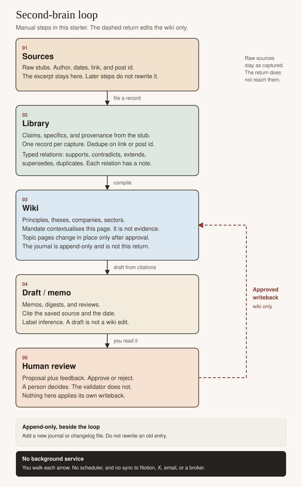
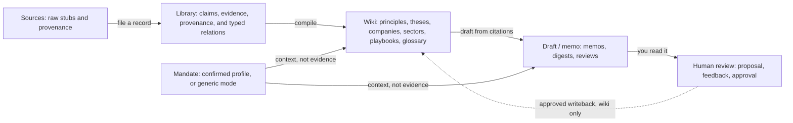

# Architecture

This is the workflow the folders, templates, prompts, and validator implement. It is a manual research loop. It is not a background service, and it is not a description of a live vault anyone already runs.

Human review and the changelog are part of this starter. You do them by editing markdown. Nothing in the repository applies a writeback on its own.



The same loop in Mermaid, for hosts that render it:



Plain-text fallback:

```text
MANUAL RESEARCH LOOP
This starter has no background service and no autonomous writeback.

A confirmed mandate contextualises the wiki and the draft.
It is not a source and it is not evidence.
Missing or unconfirmed means generic mode, not a guessed mandate.

Sources
  raw stubs, with author, dates, link, and post id
  the excerpt stays here and is not rewritten
        |
        | you file one library record for the capture
        v
Library
  claim, specifics, and the other evidence fields
  provenance copied from the source stub
  typed relations between records:
    supports, contradicts, extends, supersedes, duplicates
        |
        | you compile
        v
Wiki
  principles, theses, companies, sectors
  also playbooks and glossary
  topic pages change in place only after approval
  the journal is not on this return path; it is append-only
        |
        | you draft from citations
        v
Draft / memo
  memos, digests, and reviews
  each sourced sentence names a saved record and a date
  inference is labeled as inference
        |
        | you read it and leave feedback
        v
Human review
  a proposal you can edit, approve, or reject
  a person decides; the validator does not
        |
        | dashed line: approved writeback
        v
Wiki only
  the approved text replaces the topic page in place
  raw sources are not rewritten
  library claim sentences are not rewritten to match the new belief
  a new changelog file records the before and after
  a new journal file may record what you decided; the old entry stays

Solid steps are things you do in an editor, or by pasting a prompt
into an agent you already use. Nothing here runs on a schedule.
Nothing here syncs Notion, X, email, or a broker.
```

The drawing file is [diagrams/second-brain-loop.svg](diagrams/second-brain-loop.svg). [diagrams/second-brain-loop.txt](diagrams/second-brain-loop.txt) is the same fallback. Reuse those two if you want the picture outside this repository. They do not call a service.

## Mandate

A confirmed file at `vault/profile/mandate.md` contextualises the wiki and the draft. It is operating context. It is not a source, not evidence, and not advice. Strategy rules live in separate files under `vault/profile/strategies/` so a direct PE checklist is not the same text as a fund-selection checklist. Missing or unconfirmed means generic mode. The interview is [prompts/onboard.md](../prompts/onboard.md). The offline checker is `tools/init_mandate.py`. The map of answers to prompts is [mandate-map.md](mandate-map.md).

## What moves forward

**Sources.** A stub in `raw/` keeps the excerpt, the author, the dates, the link, and the post id. That file is the provenance. A later belief does not get written back into it.

**Library.** You file one record per capture. The claim is in your words. The link and post id match the stub, which is how the validator dedupes a second paste of the same item. Points from the same capture that are not the primary claim go in `specifics`.

Relations sit beside the records. The vocabulary is supports, contradicts, extends, supersedes, and duplicates. Direction and examples are in [schema/relations.md](../schema/relations.md).

**Wiki.** Principles, theses, companies, sectors, playbooks, and glossary pages are the layer you compile. Topic pages are allowed to change in place, and only after a person approves a proposal. A recurring principle is a compiled rule that cites at least three library records. A single fact on a company page does not need three sources. A developing principle can exist with fewer and has to say so.

**Draft / memo.** Memos, digests, and reviews are outputs. A memo has a Sources section and an Inference section. A sourced sentence names the library record and the date posted. The wiki is not treated as a source. If you use a wiki sentence, you either trace it or you label it as the page's belief.

**Human review.** The proposal is a file. You edit the wording, then set `approved` or `rejected` and sign it with a name or a role. The validator checks that an approved proposal has a reviewer and a date. It does not decide that the edit is right.

## What comes back, and what does not

The dashed return lands on a wiki topic page. The approved text replaces that page in place. A new changelog file stores the before and after. That is the whole return path.

It does not rewrite raw sources. It does not rewrite library claim sentences. It does not rewrite the journal or an older changelog entry. Those are append-only: you add a file.

The journal can record, on the day, that you approved an edit. The old journal entry that held the earlier belief stays wrong. That is the point of keeping it.

## What is deliberately absent

There is no scheduler, no watcher, and no client for Notion, X, email, a broker, or a model provider. The prompts are text you paste into an agent you already run. See [integrations.md](integrations.md).

The validator checks shape, vocabulary, and local references. It does not check whether a claim is true, and it does not fetch links.

## Worked path

[examples/low-oriole-metering/](../examples/low-oriole-metering/) walks one fictional issuer through a contradicted attach comment, a superseded backlog figure, a duplicate clip, a sourced memo, a proposal a person narrowed, an in-place company page, and a changelog. The January journal still has the old belief.
